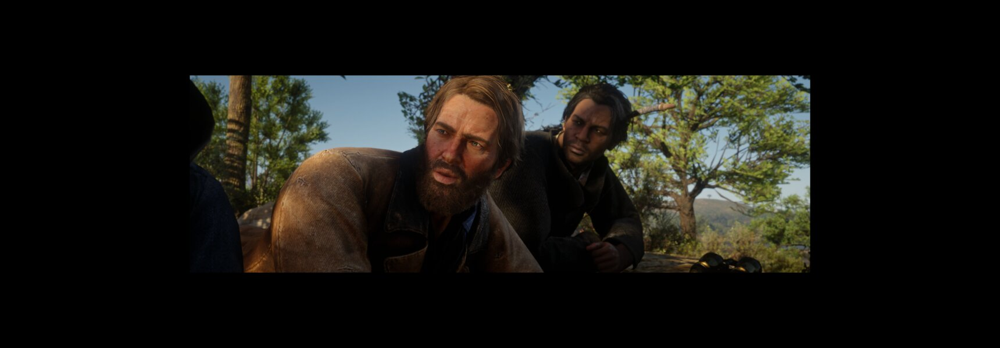
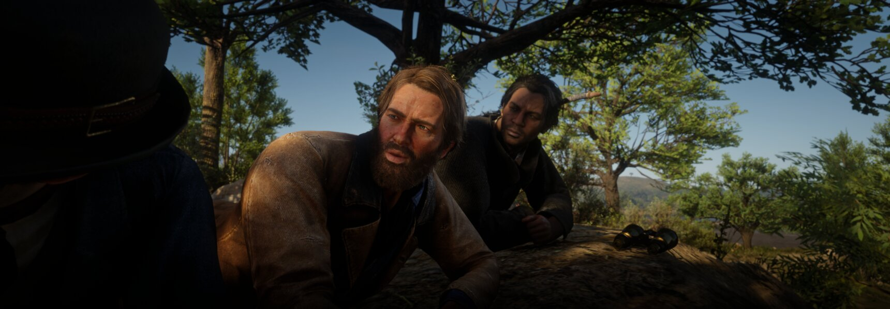
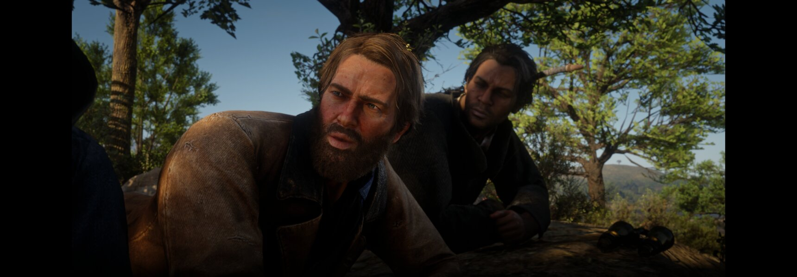
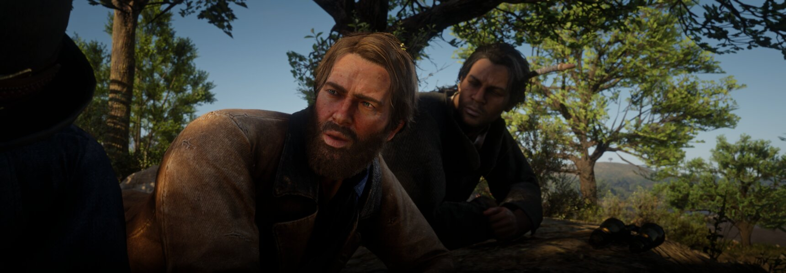

# CutsceneFit

Shows Red Dead Redemption 2 cutscenes at their intended framing on any screen
wider than 16:9, as large as the screen allows and never cropped.

Cutscenes are composed for 2.35:1. On a 16:9 screen the game shows them with
bars above and below, as intended. On wider screens it does something worse: it
fits a 16:9 box into the screen and crops that box to 2.35:1, leaving bars on all
four sides and a picture much smaller than the screen. Mods that only remove the
bars show the rest of the rendered scene, which changes the composition.

CutsceneFit narrows the camera's field of view so the 2.35:1 frame fills as much
of the screen as it can without being cropped, and fills what is left with the
game's own bars. Because they are the game's bars, resized, they still slide in
and out with the game's own animation at the start and end of a cutscene. A key
toggles those bars off to show the extra scene the game renders behind them.

It works at any aspect ratio. The plugin computes the frame and the bars from
the game window's measured aspect, so screens between the common sizes below
get the same fit. At 16:9 and narrower the game already frames cutscenes
correctly, and nothing changes.

| Screen | Frame fills | Bars                               |
| ------ | ----------- | ---------------------------------- |
| 16:9   | —           | unchanged from the game            |
| 18:9   | full width  | thinner, above and below           |
| 21:9   | full height | about 28 px each side at 3440x1440 |
| 32:9   | full height | wide, at the sides                 |

**Status:** works in cutscenes on `RDR2.exe` 1.0.1491.50, including camera
blends, tested at 3440x1440 (21:9), 3440x1200 (2.87:1) and 2880x1440 (18:9).

## Comparison

The same cutscene frame at 3440x1200 (2.87:1), taken with the
[comparison build](#comparison-build).

The game as shipped: a 16:9 box cropped to 2.35:1, with bars on all four sides.



Bars removed, as other mods do: the whole screen is used, but the camera is
unchanged, so the shot shows more of the scene than it was composed for.



CutsceneFit: the 2.35:1 shot from the first image, filling the full height, with
the game's bars at the sides.



CutsceneFit with the bars toggled off: the same framing, with the scene the game
renders behind the side bars.



## Requirements

- Red Dead Redemption 2 on PC, story mode only, version 1.0.1491.50. On other
  versions the plugin finds its code by byte patterns and stays inactive if
  any of them does not match exactly once.
- An ASI loader, such as the one in
  [Script Hook RDR2](http://www.dev-c.com/rdr2/scripthookrdr2/) or the `dinput8.dll`
  of the Mod Loader mod on Nexus Mods. Script Hook itself is not needed.

The plugin does not detect Red Dead Online. Remove it before playing Online.

## Installing

Copy `CutsceneFit.asi` into the game folder, next to `RDR2.exe`. On Linux under
Proton, add `WINEDLLOVERRIDES="dinput8=n,b" %command%` to the game's launch
options so Wine loads the ASI loader's `dinput8.dll`.

## Settings

An optional `CutsceneFit.ini` next to `CutsceneFit.asi` changes the defaults.
It is read once when the game starts.

```ini
[CutsceneFit]
enabled=1
bars=1
toggle_key=End
zoom_start=cut
aspect=0
log=1
```

| Key          | Meaning                                                                                                                                                                  |
| ------------ | ------------------------------------------------------------------------------------------------------------------------------------------------------------------------ |
| `enabled`    | `1` installs the plugin's hooks, `0` loads it and does nothing.                                                                                                          |
| `bars`       | `1` shows the bars when the game starts, `0` hides them.                                                                                                                 |
| `toggle_key` | Key that shows or hides the bars: a name (`F1`–`F24`, `A`–`Z`, `0`–`9`, `End`, `Home`, `Insert`, `Delete`, `PageUp`, `PageDown`, arrow keys, …) or a virtual-key code such as `0x23`. |
| `zoom_start` | `cut` narrows the field of view from the first camera cut after the letterbox appears until it disappears. `letterbox` narrows it whenever the letterbox is enabled.      |
| `aspect`     | Screen aspect ratio. `0` measures the game window's client area once a second.                                                                                           |
| `log`        | `1` writes `CutsceneFit.log` next to the `.asi`, `0` writes nothing.                                                                                                      |

## Building

Requires CMake and MinGW-w64 (`mingw-w64-gcc` on Arch-based systems). The
build also works with MSVC. CMake downloads
[MinHook](https://github.com/TsudaKageyu/minhook) 1.3.4 during configuration.

```sh
cmake -B build -DCMAKE_TOOLCHAIN_FILE=cmake/mingw-w64-x86_64.cmake -DCMAKE_BUILD_TYPE=Release
cmake --build build
```

The `.asi` files are written to `build/bin/`. With MSVC, configure with
`cmake -B build -A x64` and build with `cmake --build build --config Release`.

The plugin is in [`src/`](src/) and shared code in [`common/`](common/). Each
research tool is in its own directory under [`tools/`](tools/) and builds its own
`.asi`. The tools are for finding game code and are not needed to use the plugin.

### Comparison build

Takes the screenshots in [Comparison](#comparison). Build it in a separate
directory:

```sh
cmake -B build-compare -DCMAKE_TOOLCHAIN_FILE=cmake/mingw-w64-x86_64.cmake -DCMAKE_BUILD_TYPE=Release -DCUTSCENEFIT_COMPARE=ON
cmake --build build-compare
```

It writes the same `CutsceneFit.asi` name. A key switches through four states
of the same frame: the game as shipped, bars removed, CutsceneFit, and
CutsceneFit with the bars toggled off. For each state it unpauses the game for
three frames, so the game updates its bars, then pauses it again while the
screenshot is taken. Pausing requires Script Hook RDR2; without it the sequence
runs without pausing.

On Linux, run the game inside gamescope and start
`tools/compare/capture.sh <game-folder> <output-directory>` before pressing the
key. The script takes a gamescope screenshot of each state and tells the plugin
when to move on.

Settings in `[CutsceneFit]`, in this build only:

| Key               | Meaning                                                                                                                                           |
| ----------------- | ------------------------------------------------------------------------------------------------------------------------------------------------- |
| `compare_key`     | Starts or cancels the sequence. Default `F11`.                                                                                                    |
| `compare_hold_ms` | How long a state waits for the capture script's first answer. Default `1500`; set `10000` when using the script, because saving a screenshot can take longer. |
| `compare_freeze`  | `1` pauses the game during the sequence, `0` does not. Default `1`.                                                                               |

### dump.asi

Writes the game's unpacked code to a file that Ghidra can load. Copy
`build/bin/dump.asi` into the game folder and start the game. The plugin waits
until the game has unpacked its code, then writes `RDR2.dump.exe` next to
`dump.asi` (about 115 MB) and records the path in `dump.log`. If the game
folder is not writable, both go to `%LOCALAPPDATA%\CutsceneFit` instead.

An optional `dump.ini` next to `dump.asi` changes the defaults:

```ini
[dump]
output=D:\dumps\RDR2.dump.exe
max_wait_seconds=300
settle_seconds=10
```

Dumps and Ghidra projects are ignored by Git.

### watch.asi

Finds the instructions that write the drawn camera's field of view, using
hardware write watchpoints. F9 arms or disarms the watchpoints, F10 logs which
camera slots hold a field of view. Hits go to `watch.log` and `watch.trace`. The
settings in `watch.ini` are listed at the top of
[`tools/watch/dllmain.cpp`](tools/watch/dllmain.cpp).

### zoom.asi

Tests narrowing the field of view at the call to the viewport builder and
records the last 600 frames. F7 cycles the mode between off, always and
letterbox, F8 writes the last 300 recorded frames to `zoom.log` (up to 600 with
`dump_frames`), F6 removes or reinstalls
the hook. The settings in `zoom.ini` are listed at the top of
[`tools/zoom/dllmain.cpp`](tools/zoom/dllmain.cpp).

## License

MIT. Parts are adapted from
[rdr2-ultrawide-proper-black-bar-fix](https://github.com/ReneSchimmelpfennig/rdr2-ultrawide-proper-black-bar-fix),
also MIT.

The plugin includes [MinHook](https://github.com/TsudaKageyu/minhook), under the
BSD 2-Clause license. A binary release must include MinHook's `LICENSE.txt`,
which also carries the notices for the Hacker Disassembler Engine it contains,
and the MIT notice of rdr2-ultrawide-proper-black-bar-fix.
